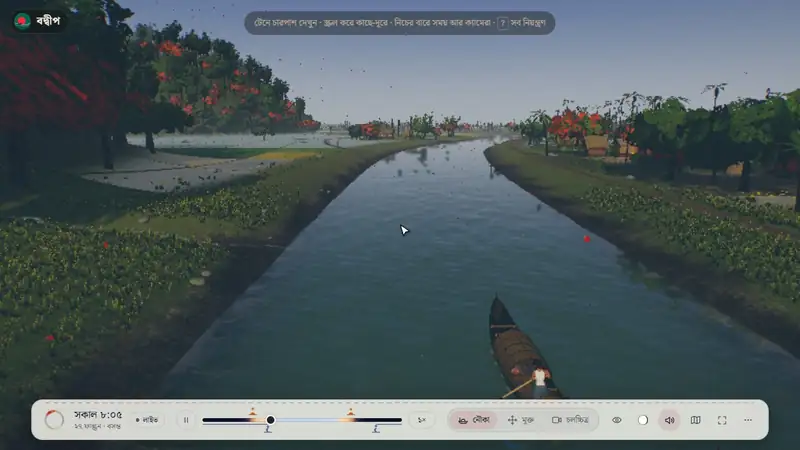
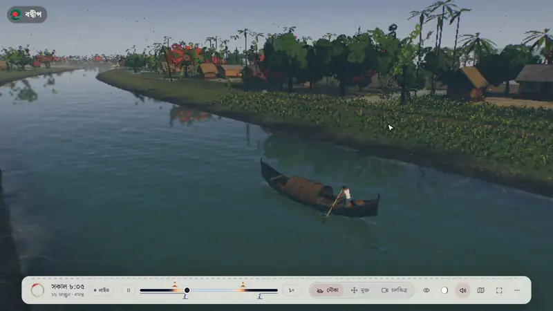
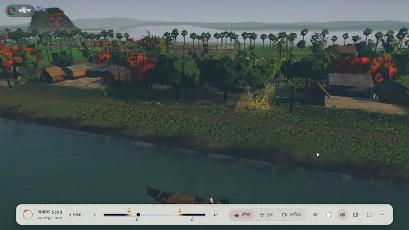
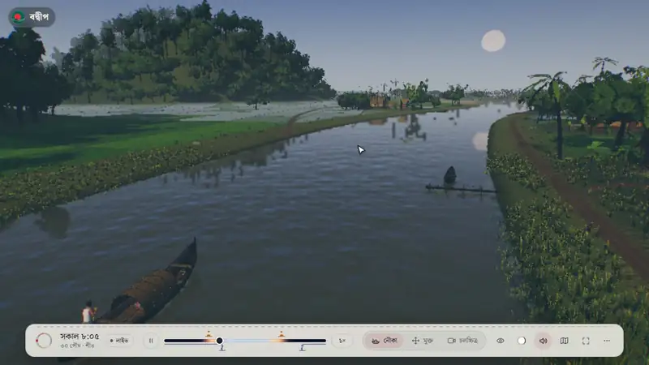
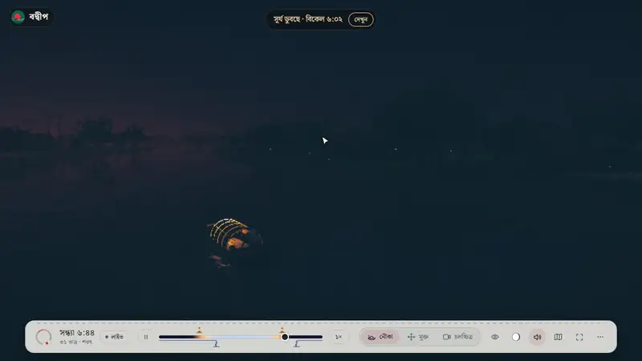
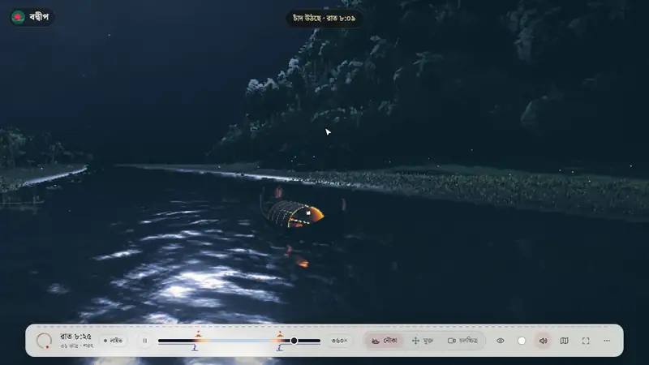
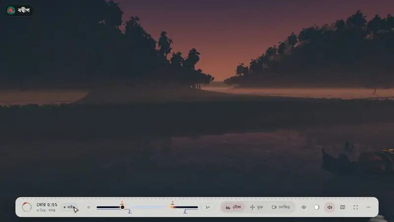
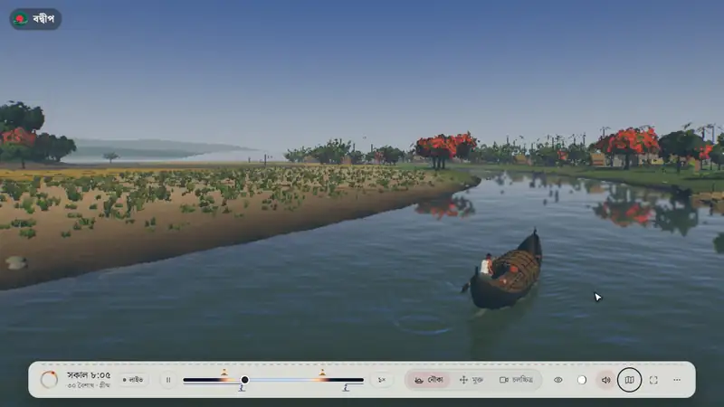
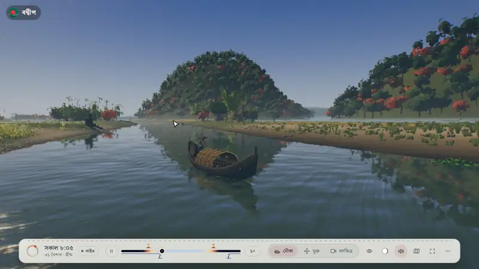
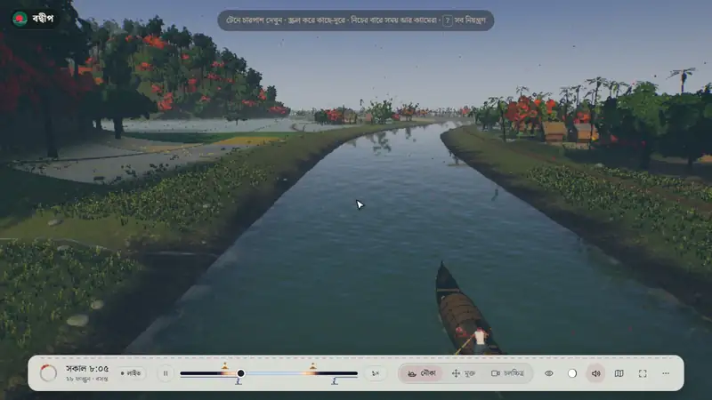

  

  <h1 align="center">Controls</h1>

  
Everything you can do in <a href="https://bodwip-3d.vercel.app/"><strong>বদ্বীপ 3D (Bodwip 3D)</strong></a>, shown in the site itself. On the site, press <kbd>?</kbd> for the full list of keys.

## Contents

- [Look Around](#look-around)
- [Camera Angles](#camera-angles)
- [The Six Seasons](#the-six-seasons)
- [Time and Its Speed](#time-and-its-speed)
- [The Moon](#the-moon)
- [Live](#live)
- [The Map](#the-map)
- [Free Camera](#free-camera)
- [The Film](#the-film)
- [Help and a Clear View](#help-and-a-clear-view)
- [Sound and Full Screen](#sound-and-full-screen)
- [All the Keys](#all-the-keys)

---

### Look Around

- **Drag** to turn round the boat; **scroll** or **pinch** to come nearer or go farther
- Keys: <kbd>←</kbd> <kbd>→</kbd> <kbd>↑</kbd> <kbd>↓</kbd> to turn, <kbd>+</kbd> <kbd>−</kbd> to zoom
- Left alone, the camera composes its own views of the boat and of the sights she passes; <kbd>R</kbd> hands it back to them

---

### Camera Angles

- The **eye** button on the bar, or <kbd>V</kbd>
- **Best view** (the camera frames its own), **from behind**, **beside the majhi**, **from the bow**, **from high**

---

### The Six Seasons

- The **ring** at the left of the bar, or <kbd>Y</kbd> for the next season
- গ্রীষ্ম, বর্ষা, শরৎ, হেমন্ত, শীত and বসন্ত: the crops, the trees, the water, fog and rain turn to the season in a few seconds and hold it for a minute
- **Let the seasons turn with the journey** gives the year back to the boat's way

---

### Time and Its Speed

- The **speed** chip (১×), or <kbd>[</kbd> <kbd>]</kbd>: slower or faster; 1× is real time. Hold <kbd>T</kbd> for very fast
- The **pause** button, or <kbd>Space</kbd>: stop time or start it again

- **Drag** the day's timeline to any hour
- Its marks are the day's sunrise, sunset, moonrise and moonset: click one to go to that moment and look that way; <kbd>N</kbd> goes to the next

---

### The Moon

- The **moon** button: pick a phase, from অমাবস্যা to পূর্ণিমা
- Then click the moonrise mark on the timeline to watch it come up

---

### Live

- **লাইভ**, or <kbd>0</kbd>: the village at Bangladesh's own date, hour, season and moon, right now
- Press again to go back to the cinematic morning

---

### The Map

- The **map** button, or <kbd>L</kbd>: the village from above, with every place to see
- Pick a place on the map or in the list to watch its own shots; then the camera comes back to the boat

---

### Free Camera

- **মুক্ত** on the bar, or <kbd>2</kbd>
- Walk with <kbd>W</kbd> <kbd>A</kbd> <kbd>S</kbd> <kbd>D</kbd> (or <kbd>↑</kbd> <kbd>↓</kbd>), look by dragging, rise and sink with <kbd>E</kbd> <kbd>Q</kbd>, hold <kbd>Shift</kbd> to go faster
- <kbd>1</kbd> goes back to the boat

---

### The Film

- **চলচ্চিত্র**, <kbd>3</kbd> or <kbd>C</kbd>: a year in the village in 25 scenes
- The arrows at the top, or <kbd>←</kbd> <kbd>→</kbd> and <kbd>PgUp</kbd> <kbd>PgDn</kbd>: the previous or the next scene
- <kbd>Esc</kbd> or a drag leaves the film

---

### Help and a Clear View

- The **mark** at the top left, **আরও** on the bar, or <kbd>?</kbd>: every control and key
- <kbd>H</kbd> hides the controls for a clear view, and brings them back

---

### Sound and Full Screen

- The **speaker**, or <kbd>M</kbd>: the village's sound, made in the browser: the water, the wind, birds and crickets, frogs in the rains, rain and thunder, the train
- The **full screen** button, or <kbd>F</kbd>

## All the Keys

| Key | Action |
|-----|--------|
| Drag, <kbd>←</kbd> <kbd>→</kbd> <kbd>↑</kbd> <kbd>↓</kbd> | Turn round the boat |
| Scroll, pinch, <kbd>+</kbd> <kbd>−</kbd> | Nearer or farther |
| <kbd>V</kbd> | Camera angle |
| <kbd>R</kbd> | Back to the best view |
| <kbd>1</kbd> <kbd>2</kbd> <kbd>3</kbd> | Boat camera, free camera, film |
| <kbd>W</kbd> <kbd>A</kbd> <kbd>S</kbd> <kbd>D</kbd>, <kbd>E</kbd> <kbd>Q</kbd>, <kbd>Shift</kbd> | Free camera: walk, rise and sink, faster |
| <kbd>Space</kbd> | Play or pause time |
| <kbd>[</kbd> <kbd>]</kbd> | Slower or faster time |
| <kbd>T</kbd> (hold) | Very fast time |
| <kbd>N</kbd> | The next sunrise, sunset, moonrise or moonset |
| <kbd>Y</kbd> | The next season |
| <kbd>0</kbd> | Live |
| <kbd>C</kbd> | The film on or off |
| <kbd>←</kbd> <kbd>→</kbd>, <kbd>PgUp</kbd> <kbd>PgDn</kbd> | The film's previous or next scene |
| <kbd>Esc</kbd> | Leave the film |
| <kbd>L</kbd> | Map |
| <kbd>M</kbd> | Sound |
| <kbd>F</kbd> | Full screen |
| <kbd>H</kbd> | Hide or show the controls |
| <kbd>?</kbd> | Every control and key |

---

<a href="https://bodwip-3d.vercel.app/"><strong>Try it yourself</strong></a> · <a href="README.md">Back to the README</a>

