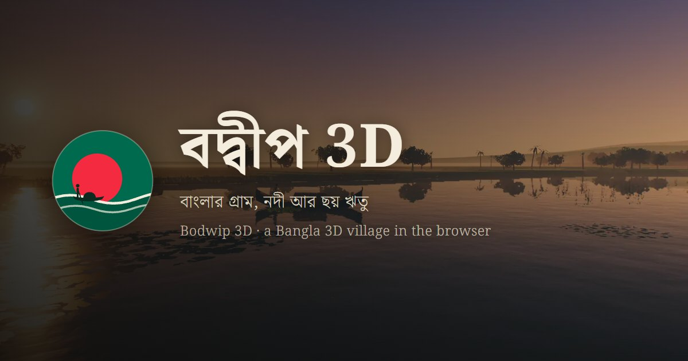
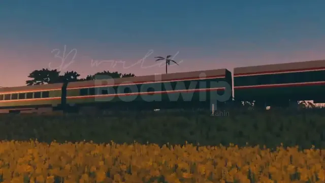
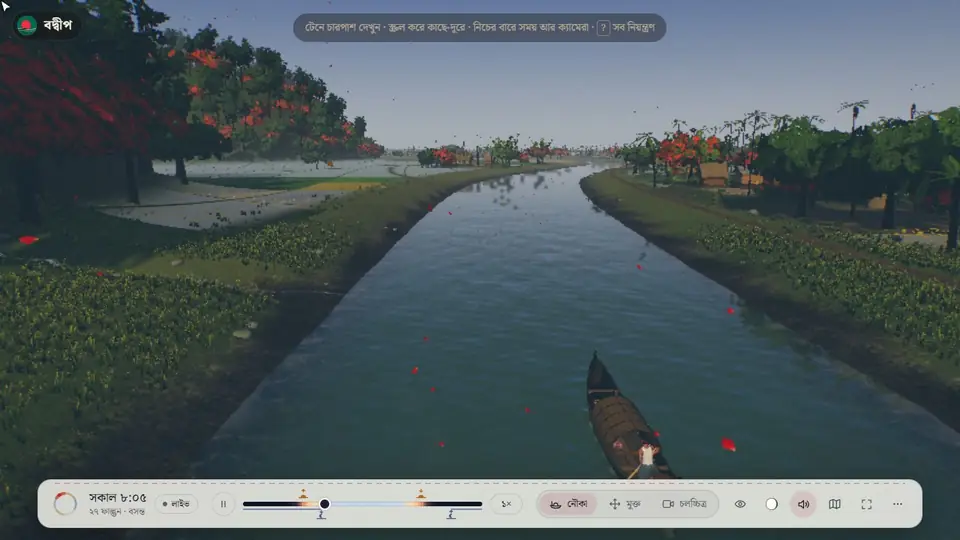

<div align="center">
  <a href="https://bodwip-3d.vercel.app/">
    
  </a>

  <h1 align="center">বদ্বীপ 3D (Bodwip 3D)</h1>

  <a href="https://bodwip-3d.vercel.app/"></a>
  
  
  
  
</div>

A real-time Bangla 3D world in the browser: an imagined village in Bangladesh, its small river, canals and a water-lily beel, seen from a country boat as its majhi paddles up the river through the six seasons. Nearly everything you see and hear, from the land, trees, water and sky to the boats and the sound, is generated in code as the page loads. Nothing to install: it runs in any modern browser with WebGL 2, on a computer or a phone. Try it live at **[bodwip-3d.vercel.app](https://bodwip-3d.vercel.app/)**.

## Preview

<div align="center">
  <a href="https://bodwip-3d.vercel.app/">
    
  </a>
</div>

<div align="center">
  <a href="https://bodwip-3d.vercel.app/">
    
  </a>
  <p><em>Pick a season, drag the day on to sunset, open the map and fly to a place: <a href="https://bodwip-3d.vercel.app/">try it yourself</a>, or see <a href="CONTROLS.md">every control in action</a>.</em></p>
</div>

## Features

### The River Journey
- From the river into a khal under an old brick bridge, up a side khal under a high bamboo sanko, to a shapla beel
- A country boat that floats on the water drawn round her, driven stroke by stroke by her majhi's paddle
- A wake behind her, water hyacinth that drifts in the slack water and gives way to her hull
- Fog over the beel at the journey's end, and the journey begins again

---

### Six Seasons and Weather
- গ্রীষ্ম, বর্ষা, শরৎ, হেমন্ত, শীত and বসন্ত turning as the boat goes, smoothly, never as a slideshow
- Crops that grow, ripen and are reaped; trees that green, dry and flower; white kash in Sharat
- The water rising in the rains, the salt farms turning into fish ghers
- One wind moving the trees, grass, crops, water, boat and clothes; drizzle, monsoon rain and the kalboishakhi with its lightning

---

### The Village
- Homesteads on their raised mounds round their yards, with ponds, ghats and moored boats
- A banyan ghat with a tea stall, a mosque by its kept pond, a graveyard, an old zamindar's house with its grand ghat
- Salt farms fed by a tidal creek that joins the river through a sluice gate
- Paddy and mustard fields, brick roads and footpaths, a railway with its intercity train
- People at work: salt rakers and carriers, reapers, a fisherman casting his net, the gher's keeper

---

### Cinematic Mode and Live Mode
- **Cinematic** - opens on the most beautiful spring morning, chosen by weighing every day of spring; the sun rises as a drone shot comes down to the boat
- **Composed camera** - left alone, the camera frames its own views of the boat and of the sights she passes
- **Live** - the village at Bangladesh's own date, hour, season and moon right now
- The sun and the moon where they really stand, the moon's phase and the Bangla date

---

### The Film and the Map
- **Film** - a year in the village in 25 scenes, one continuous film of dissolves between moving shots
- **Map** - the village drawn from above with its waters, ways and places; each place plays its own shots, then returns to the boat

---

### Life and Sound
- Fish that school and scatter, frogs in the rains, turtles basking, songbirds in the treetops, flocks over the river, fireflies at night
- Ripples wherever something touches the water: the paddle, a fish, a raindrop
- Sound made in the browser: water, wind, rain, birds, crickets, frogs, thunder, and the train with its horn and the clack of the rails

---

### UI/UX Features
- Controls in Bangla: the time, the season, Live, the camera, the moon, the sound and the map
- Mouse, keyboard and touch (drag, pinch); a free camera to walk and fly
- Adaptive resolution and quality tiers that keep slow devices smooth (`?quality=low|high`)
- A loader that is a still of this world, its mark's sun rising as the village is built

---

### Search and Sharing
- Title, description, Open Graph and Twitter cards with a share card, and structured data
- The site's address set in one place (`SITE_URL`) for its canonical link, `robots.txt` and `sitemap.xml`
- Vercel Web Analytics

## Tech Stack

| Category | Technologies |
|----------|-------------|
| Rendering | three.js r186 (WebGL 2), custom shaders and post-processing |
| Language | TypeScript 7 (strict) |
| Build | Vite 8 |
| Sound | Web Audio API, generated in code |
| Fonts | Noto Serif Bengali, Amiri (Google Fonts) |
| Analytics | Vercel Web Analytics |
| Tooling | Headless Chrome scripts for stills, icons and the share card |

## Getting Started

### Prerequisites
- Node.js 22 or higher
- A browser with WebGL 2

### Installation

1. Clone the repository:
   ```bash
   git clone https://github.com/IsHereZahin/Bodwip-3D.git
   cd Bodwip-3D
   ```

2. Install dependencies:
   ```bash
   npm install
   ```

3. Configure environment variables:
   ```bash
   cp .env.example .env
   ```

4. Production builds take the site's address from `.env.production` (`SITE_URL=https://bodwip-3d.vercel.app/`); change it there to publish somewhere else.

5. Run the development server:
   ```bash
   npm run dev
   ```

6. Open [http://localhost:5173](http://localhost:5173) in your browser.

### Scripts

| Command | Description |
|---------|-------------|
| `npm run dev` | Start the development server |
| `npm run build` | Build for production into `dist/` |
| `npm run preview` | Serve the production build |
| `npm run typecheck` | Check the types |
| `node scripts/brand/icons.mjs` | Make the icons from the logo |
| `node scripts/brand/share.mjs` | Make the share card |

### Controls

| Key | Action |
|-----|--------|
| Drag, scroll | Look around, nearer or farther |
| `1` `2` `3` | Boat camera, free camera, film |
| `C` | The film: a year in the village |
| `Space`, `[` `]` | Play or pause time, its speed |
| `0` | Live: Bangladesh right now |
| `L` | Map |
| `M`, `F`, `H` | Sound, full screen, hide the controls |
| `?` | All the keys |

Every control in action, a clip of each, is in **[CONTROLS.md](CONTROLS.md)**.

## Project Structure

```
src/
├── main.ts                # Start-up, the frame loop and the modes
├── audio/                 # The soundscape (Web Audio)
├── core/                  # Maths, noise, shared uniforms
├── env/                   # Clock, sun and moon, seasons, weather, wind
├── render/                # Shaders, materials, post-processing, textures
├── rig/                   # Cameras, the opening flight, the film, the map's visits
├── ui/                    # Controls, help, map panel, loader text
└── world/                 # The village: plan, ground, water, trees, houses, boats, people, life
public/
├── brand/                 # Logo, icons, loader still, share card
├── humans/                # The people's bodies and textures
└── textures/              # Ground and bark textures
scripts/
├── brand/                 # Icon and share-card makers
├── headless/              # Headless Chrome stills and checks
└── humans/                # The people's build
```

## Contributing

Contributions are welcome! Please feel free to open an issue or submit a pull request.

## Author

**Zahin Mohammad** – [Portfolio](https://isherezahin.vercel.app/) · [GitHub](https://github.com/IsHereZahin) · [LinkedIn](https://www.linkedin.com/in/isherezahin/) · [Facebook](https://www.facebook.com/isherezahin)

## Support

If you find this project valuable, consider [becoming a sponsor](https://github.com/sponsors/isherezahin).

---

<div align="center">

### Star & Fork

If you find this project useful, please consider giving it a **star** and **fork** to stay updated with the latest features and improvements!

[](https://github.com/IsHereZahin/Bodwip-3D/stargazers)
[](https://github.com/IsHereZahin/Bodwip-3D/fork)

</div>

<p align="center">
Built with <strong>TypeScript</strong>, <strong>three.js</strong>, <strong>WebGL</strong>, and <strong>Vite</strong> 💚 Crafted in Bangladesh
</p>
